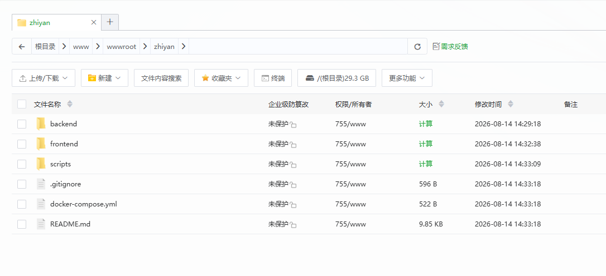
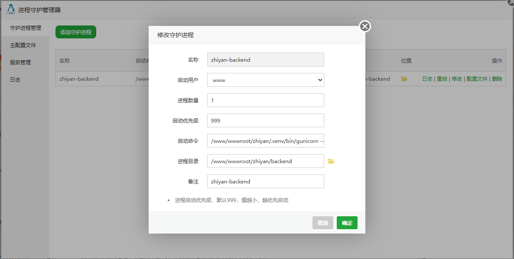

> 本文件为脱敏版：服务器地址、账户、密码等凭据已替换为占位符，原件仅保留在本地 `deployment/`（已被 .gitignore 排除）。

# 系统部署

# 云服务器相关配置说明

## 参数介绍

相关参数如下

```Bash
# 服务器公网ip
<服务器公网IP>
# 内网ip
<内网IP>

# 主机远程用户名密码如下
# 用户名
ubuntu
# 密码
<主机密码>
```

## 宝塔面板安装与配置

```Bash
#CentOS安装脚本
yum install -y wget && wget -O install.sh http://download.bt.cn/install/install_6.0.sh && sh install.sh
#Ubuntu/Deepin安装脚本
wget -O install.sh http://download.bt.cn/install/install-ubuntu_6.0.sh && sudo bash install.sh
#Debian安装脚本y
wget -O install.sh http://download.bt.cn/install/install-ubuntu_6.0.sh && bash install.sh
#Fedora安装脚本
wget -O install.sh http://download.bt.cn/install/install_6.0.sh && bash install.sh
```

我们系统配置为ubuntu，采取第二个指令进行安装。

（安装完成截图含面板凭据，未入库）

然后配置防火墙，放行14723端口，然后手动重置账户和密码：

```Plain Text
# 宝塔面板访问地址，外网访问前请先在实例安全组中放行19640端口
# 外网ipv4面板地址: https://<服务器公网IP>:14723/<安全入口>
# 内网面板地址:     https://<内网IP>:14723/<安全入口>
# username: <面板账户>    
# password: <面板密码>
```

接着，进行相关依赖数据库的安装配置：

```Plain Text
Node.js （v22.17.1）
PM2管理器
postgresql 18
pgadmin
nginx 1.26.3
Supervisor 管理器
php 8.1
```


## 文件上传与数据库配置

项目代码上传到`/www/wwwroot/zhiyan`

创建持久化目录：

```Plain Text
mkdir -p /www/wwwroot/zhiyan-data/{uploads,generated,uv-cache,ms-playwright}
chown -R www:www /www/wwwroot/zhiyan /www/wwwroot/zhiyan-data
```

创建数据库（PostgreSQL）：

```Plain Text
数据库：zhiyan
用户：zhiyan
密码：<数据库密码>
访问权限：所有人
```

上传数据库sql文件并导入。

在终端进行验证：

```Plain Text
sudo -u postgres /www/server/pgsql/bin/psql -d zhiyan -c "
SELECT schemaname, count(*) AS table_count
FROM pg_tables
WHERE schemaname IN ('zhiyan', 'knowledge_base')
GROUP BY schemaname
ORDER BY schemaname;
"
```

上传相应的代码文件：



安装后端依赖：

```Plain Text
apt install python3.12-venv
python3.12 -m venv .venv
./.venv/bin/python -m pip install --upgrade pip wheel setuptools
./.venv/bin/pip install -r backend/requirements.txt
./.venv/bin/pip install -r backend/knowledge_base_runtime/backend/requirements.txt
./.venv/bin/pip install gunicorn uv
./.venv/bin/pip install alibabacloud_aiccs20191015==5.4.2

./.venv/bin/python scripts/migrate_model_catalog.py

# 按照适配linux系统字体
sudo apt update
sudo apt install -y fonts-noto-cjk fontconfig
```

初始化业务数据（可选）

```Bash
cd /www/wwwroot/zhiyan/backend

../.venv/bin/flask --app wsgi init-research-workspace
../.venv/bin/flask --app wsgi init-academic-space
../.venv/bin/flask --app wsgi sync-builtin-agents
../.venv/bin/flask --app wsgi sync-builtin-tools
../.venv/bin/flask --app wsgi init-paper-reading
../.venv/bin/flask --app wsgi init-patent-drafting
../.venv/bin/flask --app wsgi init-academic-figure
../.venv/bin/flask --app wsgi init-arxiv-daily
```

Supervisor 启动后端



```Plain Text
/www/wwwroot/zhiyan/.venv/bin/gunicorn --chdir /www/wwwroot/zhiyan/backend --bind 127.0.0.1:5000 --workers 1 --worker-class gthread --threads 8 --timeout 3700 --graceful-timeout 60 --access-logfile - --error-logfile - wsgi:app
```

构建前端

```Plain Text
cd /www/wwwroot/zhiyan/frontend
npm ci
npm run build
```

创建PHP项目站点（这里以在php项目中创建站点为例）

在设置中配置ssh证书，并强制开启https

修改配置文件：

```Bash
server
{
    listen 80;
    listen 443 ssl;
    http2 on;

    server_name zhiyan.uc1002.xyz;

    root /www/wwwroot/zhiyan/frontend/dist;
    index index.html;

    client_max_body_size 128m;

    #CERT-APPLY-CHECK--START
    # 宝塔 SSL 证书文件验证配置，请勿删除
    include /www/server/panel/vhost/nginx/well-known/zhiyan.uc1002.xyz.conf;
    #CERT-APPLY-CHECK--END

    # 宝塔站点扩展配置
    include /www/server/panel/vhost/nginx/extension/zhiyan.uc1002.xyz/*.conf;

    #SSL-START
    #error_page 404/404.html;

    # HTTP 强制跳转 HTTPS，但放行证书验证目录
    set $isRedcert 1;

    if ($server_port != 443) {
        set $isRedcert 2;
    }

    if ($uri ~ "^/\.well-known/") {
        set $isRedcert 1;
    }

    if ($isRedcert != 1) {
        rewrite ^ https://$host$request_uri permanent;
    }

    ssl_certificate /www/server/panel/vhost/cert/zhiyan.uc1002.xyz/fullchain.pem;
    ssl_certificate_key /www/server/panel/vhost/cert/zhiyan.uc1002.xyz/privkey.pem;

    ssl_protocols TLSv1.2 TLSv1.3;
    ssl_ciphers ECDHE-ECDSA-AES128-GCM-SHA256:ECDHE-RSA-AES128-GCM-SHA256:ECDHE-ECDSA-AES256-GCM-SHA384:ECDHE-RSA-AES256-GCM-SHA384:ECDHE-ECDSA-CHACHA20-POLY1305:ECDHE-RSA-CHACHA20-POLY1305;
    ssl_prefer_server_ciphers on;

    ssl_session_tickets off;
    ssl_session_cache shared:SSL:10m;
    ssl_session_timeout 10m;

    add_header Strict-Transport-Security "max-age=31536000" always;
    add_header X-Content-Type-Options "nosniff" always;
    add_header X-Frame-Options "SAMEORIGIN" always;
    add_header Referrer-Policy "strict-origin-when-cross-origin" always;

    error_page 497 https://$host$request_uri;
    #SSL-END

    # SSL 证书验证目录
    location ^~ /.well-known/acme-challenge/ {
        allow all;
        root /www/wwwroot/zhiyan/frontend/dist;
        try_files $uri =404;
    }

    # 禁止在证书验证目录执行或访问敏感文件
    location ~ "^/\.well-known/.*\.(php|jsp|py|js|css|lua|ts|go|zip|tar\.gz|rar|7z|sql|bak)$" {
        return 403;
    }

    # 任务接口和 SSE 实时事件流
    location ^~ /api/v1/tasks/ {
        proxy_pass http://127.0.0.1:5000;
        proxy_http_version 1.1;

        proxy_set_header Host $host;
        proxy_set_header X-Real-IP $remote_addr;
        proxy_set_header X-Forwarded-For $proxy_add_x_forwarded_for;
        proxy_set_header X-Forwarded-Proto $scheme;
        proxy_set_header X-Forwarded-Host $host;
        proxy_set_header Connection "";

        proxy_buffering off;
        proxy_cache off;
        gzip off;

        proxy_connect_timeout 30s;
        proxy_send_timeout 3700s;
        proxy_read_timeout 3700s;

        add_header X-Accel-Buffering "no" always;
    }

    # Flask 普通 API
    location ^~ /api/ {
        proxy_pass http://127.0.0.1:5000;
        proxy_http_version 1.1;

        proxy_set_header Host $host;
        proxy_set_header X-Real-IP $remote_addr;
        proxy_set_header X-Forwarded-For $proxy_add_x_forwarded_for;
        proxy_set_header X-Forwarded-Proto $scheme;
        proxy_set_header X-Forwarded-Host $host;

        proxy_connect_timeout 30s;
        proxy_send_timeout 300s;
        proxy_read_timeout 300s;
    }

    # Vite 带哈希的静态资源
    location ^~ /assets/ {
        try_files $uri =404;

        expires 30d;
        add_header Cache-Control "public, max-age=2592000, immutable";

        access_log off;
        log_not_found off;
    }

    # 首页不进行长期缓存，避免发布后仍加载旧资源
    location = /index.html {
        try_files $uri =404;

        expires -1;
        add_header Cache-Control "no-cache, no-store, must-revalidate";
    }

    # Vue Router History 路由支持
    location / {
        try_files $uri $uri/ /index.html;
    }

    # 禁止访问敏感文件
    location ~* (^|/)(\.user\.ini|\.htaccess|\.htpasswd|\.env.*|\.project|\.bashrc|\.bash_profile|\.bash_logout|\.DS_Store|\.gitignore|\.gitattributes)$ {
        return 404;
    }

    location ~* /(LICENSE|README\.md|CLAUDE\.md|CHANGELOG\.md|CONTRIBUTING\.md|TODO\.md|FAQ\.md|composer\.json|composer\.lock|package(-lock)?\.json|yarn\.lock|pnpm-lock\.yaml|docker-compose\.yml|docker\.env|Dockerfile|pyproject\.toml|requirements\.txt)$ {
        return 404;
    }

    location ~* \.(sql|sql\.gz|log|bak|backup|old|tmp|temp|swp|swo)$ {
        return 404;
    }

    # 禁止访问敏感目录
    location ~* /(\.git|\.svn|\.bzr|\.vscode|\.claude|\.idea|\.ssh|\.github|\.npm|\.yarn|\.pnpm|\.cache|\.husky|node_modules)/ {
        return 404;
    }

    access_log /www/wwwlogs/zhiyan.uc1002.xyz.log;
    error_log /www/wwwlogs/zhiyan.uc1002.xyz.error.log;
}
```

